<div align="center">



<br/>


</div>

---

### 01 / WHO I AM

Data Analyst & aspiring Data Scientist passionate about transforming data into actionable insights. Skilled in Python, SQL, Power BI, Excel, and Machine Learning.

```js
const dhirubhai = {
  title: "Python Django Backend Developer | Data Science Enthusiast",
  stack: [
    "Python", "Django", "Django REST Framework (DRF)", "FastAPI",
    "SQL", "MySQL", "PostgreSQL", "SQLite",
    // ...apni purani README ke baaki items yahan paste karo
  ],
};
```

### 02 / STACK


### 03 / FEATURED PROJECT

**[ShopEase](https://github.com/Dhirubhai06/shopease-ecommerce)**: full-stack e-commerce app (Django REST Framework + React).

- AI shopping assistant for natural-language product search
- Cart, checkout, Razorpay (test mode), invoice PDF, order tracking
- Wishlist, saved addresses, reviews, Swagger API docs

### 04 / CONNECT

<!-- apne links yahan daalo -->
[Email](mailto:your-email@example.com) · [LinkedIn](https://www.linkedin.com/in/your-profile)

<div align="center">
<sub>DATA · BACKEND · INSIGHTS</sub>
</div>
